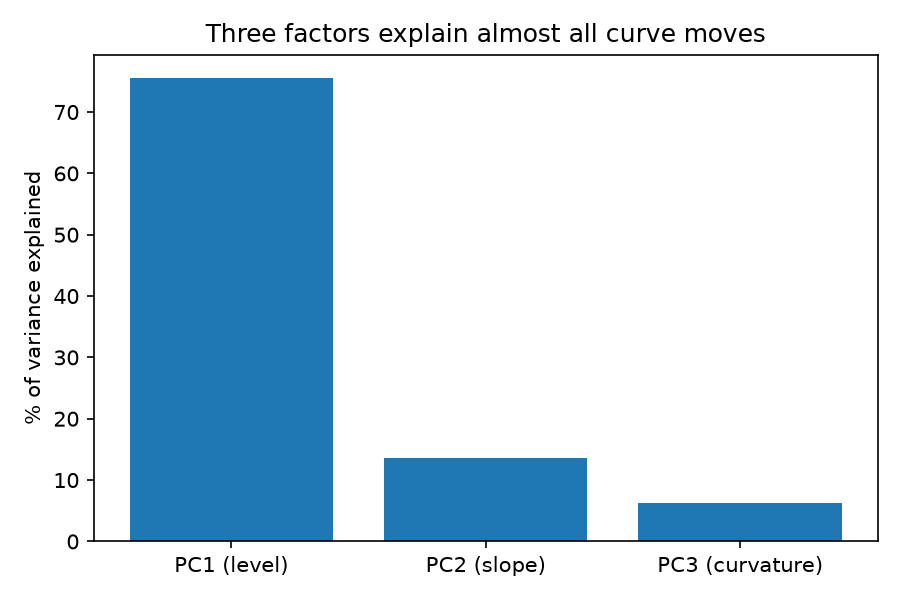
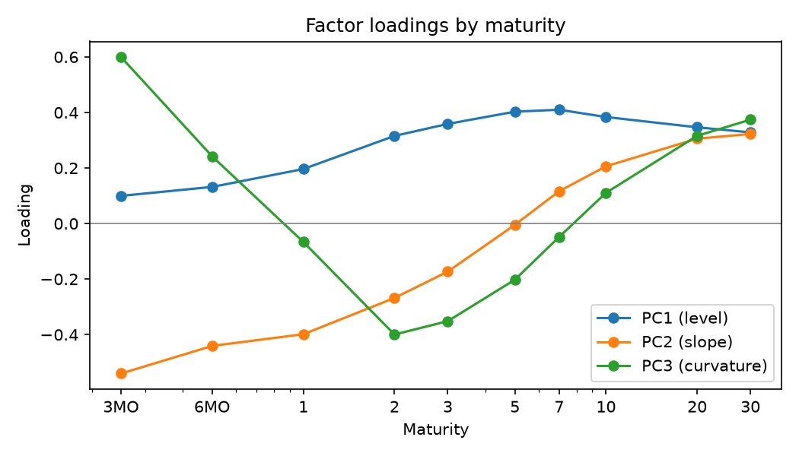
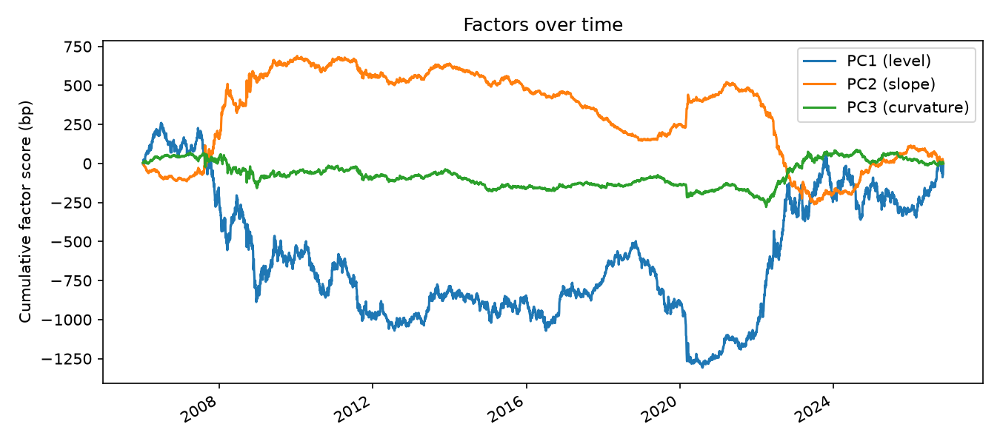
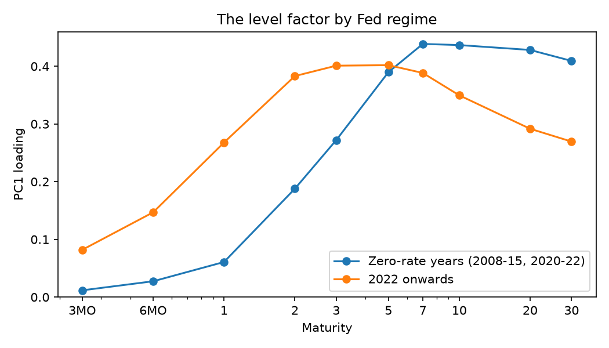

# Yield curve PCA on US Treasuries

How many independent factors drive the US Treasury curve, and do they change with the Fed's policy regime?

## Summary

- Three factors explain 95.6% of daily moves in ten Treasury yields (3-month to 30-year) from January 2006 to November 2026.
- The factors have the standard shapes: level (75.6%), slope (13.7%) and curvature (6.3%).
- The level factor is not stable across regimes. When the Fed held rates at zero, it was a long-end factor and yields under 1 year barely took part. Since the 2022 hiking cycle it has been centred on the 2-year to 5-year sector.

## Method

1. Download daily constant-maturity Treasury yields from FRED (3M, 6M, 1Y, 2Y, 3Y, 5Y, 7Y, 10Y, 20Y, 30Y).
2. Take daily changes in basis points. Changes are used instead of levels because yield levels trend over time, and a PCA on levels would mostly pick up that trend.
3. Run PCA on the changes and keep the first three components.
4. Repeat on sub-samples: without bills, in the zero-rate years, and from 2022 onwards.

## Results

### Full sample





- **PC1 (level):** all loadings are positive, peaking at 7 years (0.41). The 3-month bill loads only 0.10.
- **PC2 (slope):** rises from -0.54 at 3 months to +0.32 at 30 years, crossing zero at 5 years.
- **PC3 (curvature):** positive at both ends, negative at 2 to 3 years.



The cumulative scores track the main episodes in rates: the cuts to zero in 2008 and 2020 (level down, slope up), and the 2022-23 hiking cycle (level up sharply, slope down as the curve inverted).

### By sample

| Sample | PC1 | PC2 | PC3 | Total |
|---|---|---|---|---|
| Full sample, all maturities | 75.6 | 13.7 | 6.3 | 95.6 |
| Full sample, 2y to 30y only | 87.6 | 9.8 | 1.3 | 98.7 |
| Zero-rate years (2008-15, 2020-22) | 85.9 | 8.4 | 2.1 | 96.4 |
| 2022 onwards | 81.9 | 10.5 | 4.1 | 96.5 |

- Dropping bills lifts PC1 from 75.6% to 87.6%. Bills follow the current policy rate, which moves in steps at Fed meetings, so they behave differently from the rest of the curve.
- PC1 explains more within each regime (85.9% and 81.9%) than across the full sample (75.6%). One set of factors fitted to 20 years blends regimes that behave differently.



- **Zero-rate years:** the level loading is close to zero out to 1 year and flat at about 0.43 from 7 to 30 years. With the policy rate pinned, the main driver of the curve was the long end.
- **2022 onwards:** the loading peaks at 3 to 5 years (0.40) and falls to 0.27 at 30 years. The main driver became the repricing of the Fed's path over the next few years.

## Limitations

- Loadings are normalised to length one, so the regime chart compares the shape of the level factor, not the size of moves in basis points.
- FRED constant-maturity yields are interpolated from a fitted curve. That smoothing probably overstates how much three factors explain compared with traded bonds.
- The regime dates are set by hand from the Fed funds target range.
- Everything is in-sample. The project describes the curve and does not test a trading strategy.

## Run it

```
python -m venv .venv
.venv\Scripts\activate        # Mac/Linux: source .venv/bin/activate
pip install -r requirements.txt
python yield_curve_pca.py
```
